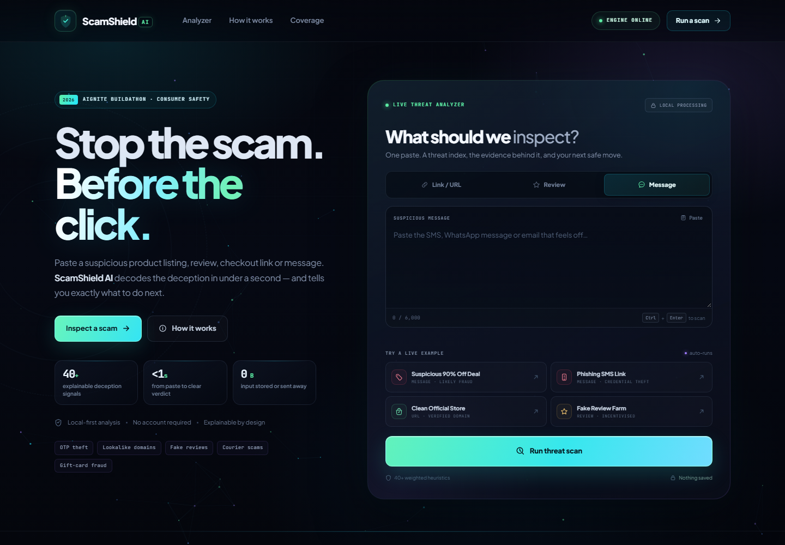
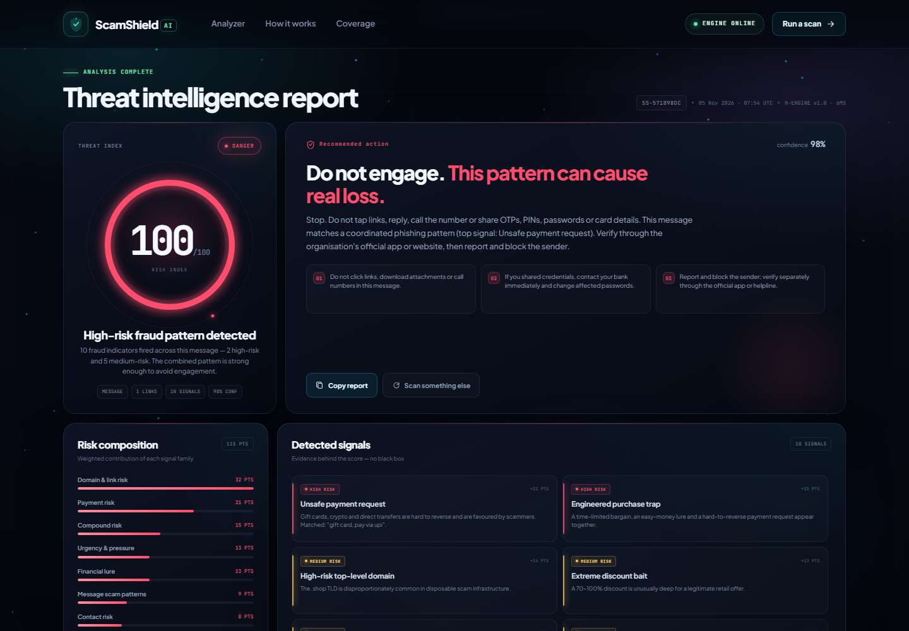
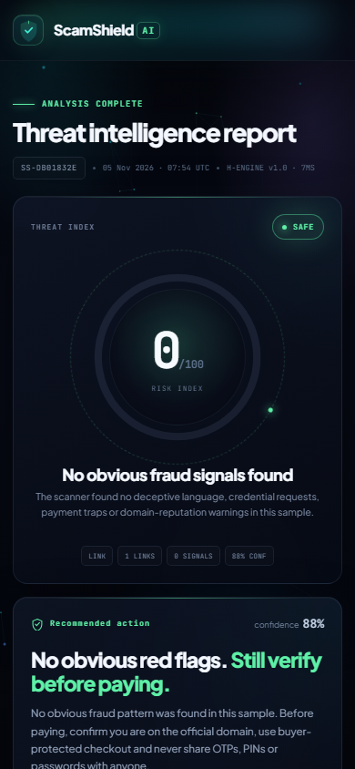

# ScamShield AI

### An autonomous consumer fraud & phishing sentinel

**ScamShield AI** turns any suspicious link, product review or message into a clear
0–100 threat index, an evidence-backed risk breakdown, and a plain-language next move.
It is built for online shoppers — not security analysts.

> Built for **Ostad Presents YUnet AIgnite Buildathon 2026** · National AI Hackathon for B2C Solutions.

**Repository:** [github.com/hariprasath71811-max/scamshield-ai](https://github.com/hariprasath71811-max/scamshield-ai)



---

## Why it exists

Consumer fraud is now designed for speed: a 90%-off "deal", a failed-delivery SMS,
a fake five-star review, a lookalike checkout page. The victim is expected to act
before they think. ScamShield inserts a deliberate, explainable check between the
message and the click.

**One paste → a verdict → evidence → a safer action.**

### What judges can try in one click

| Preset | Expected result | What it demonstrates |
| --- | --- | --- |
| Suspicious 90% Off Deal | **DANGER · 100/100** | Compound financial, payment and domain risk |
| Phishing SMS Link | **DANGER · 100/100** | OTP harvesting, KYC pretext, brand impersonation |
| Clean Official Store | **SAFE · 0/100** | Verified-domain allowlist and low-risk scoring |
| Fake Review Farm | **WARNING · 52/100** | Review authenticity and incentivised-praise signals |

Each preset auto-runs when clicked, so a live demo takes seconds.

---

## Product experience

| Threat intelligence report | Mobile |
| --- | --- |
|  |  |

The interface is a single self-contained `public/index.html` with:

- Dark glassmorphism UI with neon risk states.
- Interactive Canvas particle network that responds to pointer movement.
- Animated 0–100 circular meter that counts up to the verdict.
- Pulsing `SAFE`, `WARNING` and `DANGER` badges.
- Animated risk-composition bars and staggered evidence cards.
- Hover tilt, focus states, reduced-motion support and mobile layouts.
- One-click sample presets, clipboard paste and shareable-report copy.
- No framework, no bundler, no CDN JavaScript, no build step for the frontend.

---

## Architecture

```text
┌──────────────────────────── Browser ────────────────────────────┐
│  public/index.html — inline CSS + vanilla JS                     │
│  · Canvas particle field        · animated threat meter          │
│  · sample presets               · report copy / share            │
└───────────────────────────────┬─────────────────────────────────┘
                                │ POST /api/analyze (JSON)
┌───────────────────────────────▼─────────────────────────────────┐
│  Java HTTP server — com.sun.net.httpserver.HttpServer            │
│                                                                  │
│  StaticHandler  → serves public/ safely                          │
│  AnalyzeHandler → parses JSON, validates, scores, responds       │
│  HealthHandler  → GET /api/health                                │
│                                                                  │
│  Explainable heuristic engine                                    │
│  · language & pressure signals                                   │
│  · credential / payment / review intelligence                    │
│  · URL + domain reputation checks                                │
│  · brand impersonation + lookalike detection                     │
│  · compound-risk weighting + capped 0–100 score                  │
└──────────────────────────────────────────────────────────────────┘
```

**Deliberately dependency-free.** The server, JSON parser/stringifier, static-file
handling and scoring engine all live in `src/Main.java`. It runs on Java 11+ with
no Maven, Gradle, Spring or npm setup.

---

## Quick start

### Requirements

- Java **11 or newer** (`java -version`, `javac -version`)
- No database
- No API keys
- No third-party packages

### Windows

```bat
cd scamshield-ai
run.bat
```

### macOS / Linux

```bash
cd scamshield-ai
chmod +x run.sh
./run.sh
```

### Manual commands (any OS)

```bash
cd scamshield-ai
mkdir -p out
javac --release 11 -d out src/Main.java
java --add-modules jdk.httpserver -cp out Main
```

Open **http://localhost:8080/**.

Custom port or host:

```bash
java --add-modules jdk.httpserver -cp out Main --port 9090
java --add-modules jdk.httpserver -cp out Main --host 0.0.0.0 --port 8080
```

`PORT` environment variable is also supported, which is useful on hosting platforms.

---

## API

### `POST /api/analyze`

Request:

```json
{
  "content": "URGENT: Your account will be suspended. Verify your OTP at http://sbi-kyc-verify.top/login",
  "type": "message"
}
```

`type` is one of `url`, `review` or `message`. Content is limited to 6,000 characters.

Bash / Git Bash:

```bash
curl -X POST http://localhost:8080/api/analyze \
  -H "Content-Type: application/json" \
  -d '{"content":"URGENT: Your account will be suspended. Verify your OTP at http://sbi-kyc-verify.top/login","type":"message"}'
```

PowerShell:

```powershell
$body = @{
  content = "URGENT: Your account will be suspended. Verify your OTP at http://sbi-kyc-verify.top/login"
  type = "message"
} | ConvertTo-Json

Invoke-RestMethod -Method Post `
  -Uri "http://localhost:8080/api/analyze" `
  -ContentType "application/json" `
  -Body $body
```

Response shape (abridged):

```json
{
  "score": 100,
  "status": "DANGER",
  "headline": "Dangerous destination detected",
  "summary": "12 fraud indicators fired across this message — 6 high-risk and 5 medium-risk.",
  "recommendation": "Stop. Do not tap links, reply, call the number or share OTPs...",
  "actions": [
    "Do not click links, download attachments or call numbers in this message.",
    "If you shared credentials, contact your bank immediately and change affected passwords.",
    "Report and block the sender; verify separately through the official app or helpline."
  ],
  "details": [
    {
      "id": "domain_brand",
      "title": "Brand name used on an unverified domain",
      "description": "The host references \"Sbi\" but is not on the verified official-domain list.",
      "category": "Impersonation",
      "severity": "HIGH",
      "points": 28
    }
  ],
  "breakdown": [
    { "label": "Impersonation", "points": 48 },
    { "label": "Domain & link risk", "points": 32 }
  ],
  "safeChecks": [],
  "confidence": 98,
  "inputType": "message",
  "reportId": "SS-A1B2C3D4",
  "analyzedAt": "05 Nov 2026 · 07:49 UTC",
  "metrics": {
    "linksInspected": 1,
    "trustedDomains": 0,
    "untrustedDomains": 1,
    "highSeveritySignals": 6,
    "mediumSeveritySignals": 5,
    "charactersAnalyzed": 99
  },
  "processingMs": 12
}
```

### `GET /api/health`

```json
{
  "status": "ok",
  "service": "ScamShield AI",
  "version": "1.0.0",
  "engine": "ScamShield Explainable Heuristic Engine v1.0",
  "uptimeSeconds": 42
}
```

### Status thresholds

| Score | Status | Meaning |
| --- | --- | --- |
| `0–29` | `SAFE` | No meaningful fraud combination found |
| `30–69` | `WARNING` | Ambiguous or moderate signals; verify independently |
| `70–100` | `DANGER` | High-risk pattern; do not engage |

Scores are capped at 100. Signals are weighted, deduplicated and supplemented by
compound rules. For example, urgency + OTP request + a hostile link is more
dangerous than any one of those signals alone.

### What the engine inspects

- **Domain & link risk:** HTTP, bare IP hosts, punycode/Unicode hosts, shorteners,
  risky TLDs, embedded user-info, deep subdomains, unusual ports, sensitive paths
  (`/login`, `/kyc`, `/verify`, `/claim`), redirects, APK downloads and encoding tricks.
- **Impersonation:** brand references on non-allowlisted domains, lookalike labels
  (including leetspeak such as `amaz0n`) and brand-to-destination mismatches.
- **Credential theft:** OTP, PIN, CVV, password, Aadhaar/PAN, card and KYC requests.
- **Financial & payment risk:** extreme discounts, gift cards, crypto, wire transfers,
  easy money, guaranteed returns and irreversible deposits.
- **Pressure tactics:** deadlines, account threats, legal threats, secrecy and off-platform contact.
- **Review forensics:** incentivised reviews, stacked superlatives, missing first-hand
  detail and direct purchase pressure.
- **Language red flags:** hidden Unicode, uppercase pressure and excessive punctuation.

The official-domain allowlist is deliberately conservative and includes major Indian
and Bangladeshi commerce, banking and logistics brands. It is a helpful check, not
a guarantee: a domain not being on the list is not proof of fraud on its own.

---

## Project structure

```text
scamshield-ai/
├── .github/
│   └── workflows/
│       └── ci.yml               # compile check on push / pull request
├── docs/
│   └── screenshots/
│       ├── home.png
│       ├── mobile.png
│       └── threat-report.png
├── public/
│   └── index.html               # complete UI: inline CSS + vanilla JS
├── src/
│   └── Main.java                # HTTP server + JSON + risk engine
├── .dockerignore
├── .gitignore
├── Dockerfile                   # deployment-ready container
├── LICENSE                      # MIT
├── README.md
├── SUBMISSION.md                # Devpost-ready project copy
├── run.bat                      # Windows one-command runner
└── run.sh                       # macOS/Linux runner
```

---

## Security & privacy choices

- **Local-first:** content is analysed in memory and is never written to disk or logged.
- **Zero external AI calls:** no prompts, API keys or consumer data leave the server.
- **Body and input limits:** 128 KB request cap, 6,000-character content cap.
- **Path-traversal protection:** static paths are normalised and confined to `public/`.
- **Security headers:** CSP, `X-Frame-Options: DENY`, `nosniff`, referrer policy,
  permissions policy and no-store API responses.
- **No third-party JS:** the UI is self-contained. Google Fonts is an optional
  enhancement with a system-font fallback.
- **Safe demo examples only:** sample content is synthetic and included for judging.

For a public production deployment, add rate limiting, request authentication where
appropriate, centralized observability, a managed domain-reputation feed and abuse monitoring.

---

## Deployment

### Docker

```bash
docker build -t scamshield-ai .
docker run --rm -p 8080:8080 -e PORT=8080 scamshield-ai
```

Open **http://localhost:8080/**. The container binds to `0.0.0.0` so Render, Railway,
Fly.io, Azure Container Apps and similar platforms can route traffic to it.

### Platform notes

- Use the included `Dockerfile`.
- Set the platform's port through `PORT` or pass `--port`.
- Health check path: `/api/health`.
- No database, secrets or environment variables are required.
- The frontend and API are served by the same origin, so no CORS configuration is needed.

---

## Git & GitHub

Published at **[github.com/hariprasath71811-max/scamshield-ai](https://github.com/hariprasath71811-max/scamshield-ai)**.
The repository is public, uses `main` as the default branch, and contains the initial
project commit.

```bash
git clone https://github.com/hariprasath71811-max/scamshield-ai.git
cd scamshield-ai
```

To publish later changes:

```bash
git add .
git commit -m "describe your change"
git push
```

The included `.gitignore` keeps compiled classes and local noise out of version
control.

---

## Verification

```bash
# Compile exactly as the CI workflow does
javac --release 11 -d out src/Main.java

# Start, then check the engine
curl http://localhost:8080/api/health

# Run a scan
curl -X POST http://localhost:8080/api/analyze \
  -H "Content-Type: application/json" \
  -d '{"content":"90% OFF only today! Pay by gift card. http://amaz0n-deals.shop/claim","type":"message"}'
```

The UI has no build step. Open `http://localhost:8080/` and click any preset.

---

## Honest limitations

ScamShield AI is an explainable heuristic risk engine, not a certified fraud oracle.
It can produce false positives and false negatives. It does not fetch or execute the
submitted links, does not call external reputation services and cannot guarantee that
a domain is safe. Use the verdict to slow down and verify — not as a substitute for
bank advice, legal advice or the platform's buyer protection.

**If money or credentials have already been shared, contact your bank immediately
and report the incident to your local cybercrime authority.**

---

Built with pure Java, HTML5, CSS3 and vanilla JavaScript. No frameworks were harmed.
